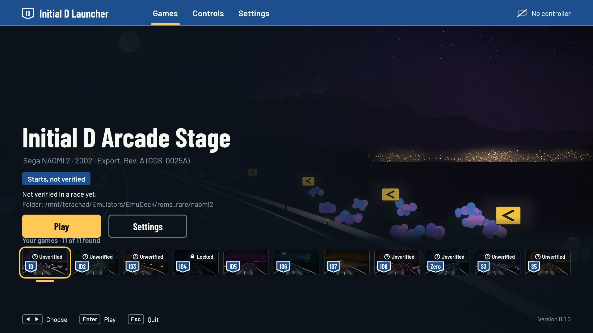
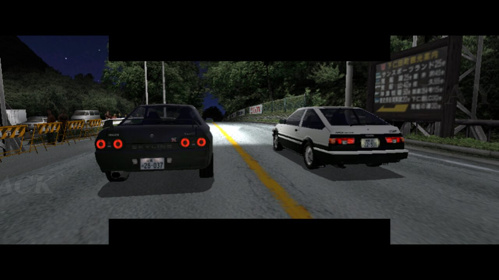
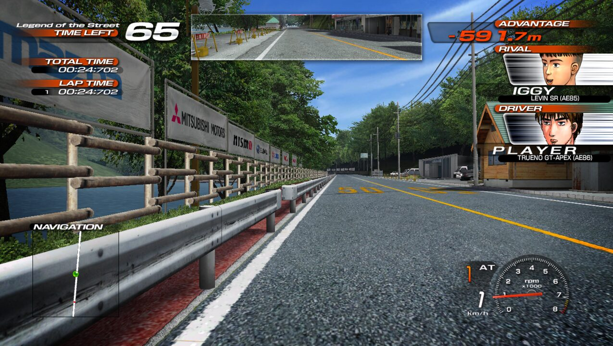
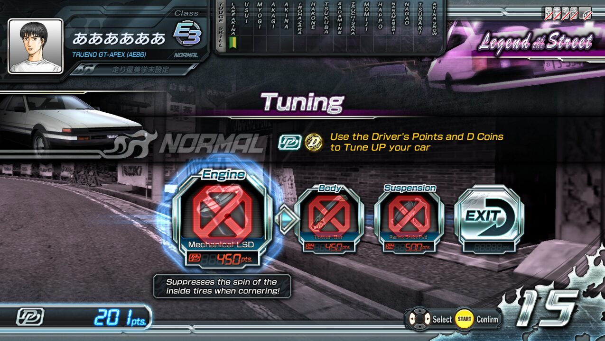
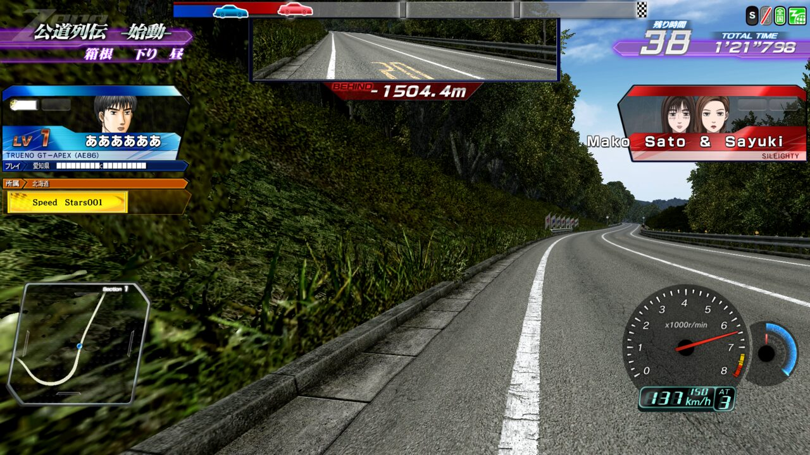
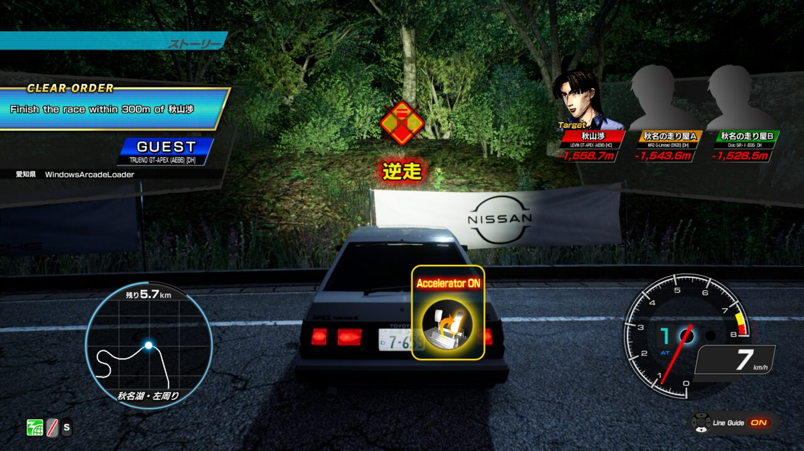
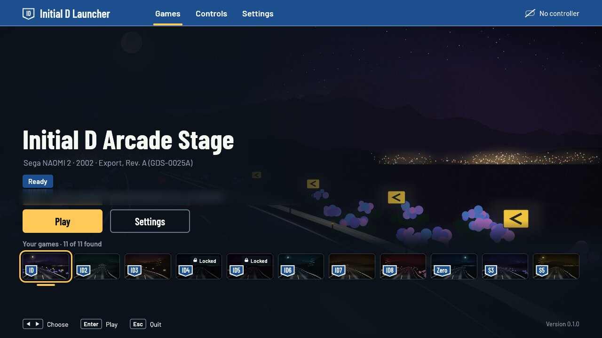

# Initial D Arcade Series Launcher

One launcher for the Initial D arcade games, from Arcade Stage Ver. 1
(2002) to THE ARCADE Season 5 (2025), on Linux and Windows. Point it at
the folders with your own game dumps and press **Play**: it finds each
game, sets up the right loader, and runs it full screen with your pad or
wheel. Built on
[rea-launcher-sdk](https://github.com/akitaonrails/rea-launcher-sdk).



No game files are included or downloaded. Your game folders are only
read, never changed: every game runs from a private folder that links to
your dump.

| | |
|---|---|
|  |  |
| Arcade Stage Ver. 1 (NAOMI 2, Flycast) | Arcade Stage 4: crashed at every game start before this launcher's fix |
|  |  |
| Arcade Stage 8 Infinity | Arcade Stage Zero Ver. 2: stayed on its steering calibration screen before the fix |
|  |  |
| THE ARCADE Season 5 | The Windows version (Initial D 4 and 5 are Linux-only) |

## What runs

| Game | Board | How it runs | Linux | Windows |
|---|---|---|---|---|
| Arcade Stage (Export Rev. A) | NAOMI 2 | Flycast | **plays** | boots (under Wine) |
| Arcade Stage Ver. 2 (Export) | NAOMI 2 | Flycast | **plays** | not yet run |
| Arcade Stage Ver. 3 (Export) | NAOMI 2 | Flycast | **plays** | not yet run |
| Arcade Stage 4 (Export Rev. D, 1.5) | Lindbergh | lindbergh-loader, natively (patched) | **plays** | no (Linux game) |
| Arcade Stage 5 (Export 2.0) | Lindbergh | lindbergh-loader, natively | **plays** | no (Linux game) |
| Arcade Stage 6 AA (Japan) | RingEdge | windowsarcadeloader | **plays** | **plays** (under Wine) |
| Arcade Stage 7 AAX (Japan) | RingEdge | windowsarcadeloader | **plays** | not yet run |
| Arcade Stage 8 Infinity (Japan) | RingEdge | windowsarcadeloader | **plays** | not yet run |
| Arcade Stage Zero Ver. 2 (2.30.00) | Nu | windowsarcadeloader (patched) | **plays** | **plays** (under Wine, see below) |
| THE ARCADE Season 3 (2.31.00 Rev. 1) | ALLS UX | windowsarcadeloader | **plays** | not yet run |
| THE ARCADE Season 5 (3.10.00 Rev. 1) | ALLS UX | windowsarcadeloader | **plays** | **plays** (under Wine, see below) |

"Plays" means a race was driven in the real game through the launcher,
with its own input path; each run is recorded in
[docs/RUNTIME_NOTES.md](docs/RUNTIME_NOTES.md). The Windows version was
tested only under Wine so far, not on a Windows PC; under Wine the
cabinet drive letters of Zero and Season 5 had to be stood in for (Wine
does not apply `DefineDosDevice` to its files). Only the exact builds
listed in the hub are started (each is identified by the SHA-256 of its
main file, or the SHA-1 of the GD-ROM); another build shows its digest so
you can report it.

## Why not just TeknoParrot?

TeknoParrot is the usual way to play these dumps on a PC. This is what we
ran into setting these games up, especially on Linux (details in
[docs/RESEARCH.md](docs/RESEARCH.md) and
[docs/RUNTIME_NOTES.md](docs/RUNTIME_NOTES.md)).

- **It is a Windows .NET program.** TeknoParrotUI needs the .NET Framework
  4.6.2; under Wine it needs a dedicated prefix, crashes under Wine 11's
  new WoW64, and every game then needs its own tuning. Our attempt to run
  it under Wine was shelved.
- **The core is closed.** The loader for Initial D 6, 7, 8 and THE ARCADE is
  a closed binary that only runs from TeknoParrot's UI; nobody can fix it
  or ship it.
- **Paid tiers.** Season 5's profile and the NAOMI 2 options (internal
  resolution, CRT shader, force feedback) are marked Patreon-only.
- **Initial D 4 and 5 are Linux programs.** TeknoParrot runs them through a
  Linux emulation layer on Windows: on Linux that is a Linux game through
  Windows through Wine.
- **The dumps are TeknoParrot-modified.** Initial D 4's program is changed,
  so the open loader's own check calls it "not clean", and with that loader
  the game crashed at the start of every game. The cause turned out to be
  the loader's, not the dump's (see the fix below).
- **Sound crashes under Wine.** The RingEdge games (6, 7, 8) crash on Wine's
  own XAudio2 as soon as a race loads.
- **First boots that never finish.** Zero's dump isn't laid out like the
  cabinet (Error 4104), its steering calibration never takes Start, and
  Season 5's very first start stays on "Initializing".
- **Controls are set up per game**, by device, in the UI.

## What this launcher does about it

- **Open loaders only, no TeknoParrot:** lindbergh-loader natively for 4 and
  5, windowsarcadeloader for 6 to THE ARCADE, Flycast for the NAOMI 2
  games. Each is built from a pinned source with this project's patches.
- **Initial D 4 fixed.** lindbergh-loader turns the game's card reader into
  a file-backed one without giving it the memory it writes to: the write
  landed on the controls object and the game crashed when a game started.
  Found with a hardware watchpoint; `patches/lindbergh` gives the object
  its size.
- **Zero fixed.** windowsarcadeloader held the Start button until the game
  server had answered, which only happens after the steering calibration
  of a first boot. `patches/wal/0002` lets Start through and makes the card
  reader wait instead. The runtime gives Zero the cabinet's `package\`
  layout (no more Error 4104).
- **Season 5's first boot**: the launcher sees the cabinet's system file
  appear and starts the game again by itself.
- **Sound that doesn't crash**: the Wine prefix gets Microsoft's XAudio2
  (winetricks `xact`).
- **Your dumps stay untouched.** Logs, saves and settings land in the
  game's private folder; on Linux every library folder is mounted
  read-only around the game.
- **Clean exit.** Stopping a game ends the loader, the game and its helper
  programs (amdaemon, the store server) and gives back what was set up.

## What it adds

- **One hub for the whole series**, with an original illustration per game,
  driven by pad, keyboard or mouse.
- **Wheel and pad support for every game.** Pads and wheels are read once
  with SDL: analog steering and pedals, a stick dead zone, sequential
  shifting on the shoulder buttons or a wheel's paddles, wheels recognised
  from the SDK's table. The Windows-built games get them through
  windowsarcadeloader's virtual stick, and their force feedback is played
  back on your wheel. The Controls page shows live steering, pedals and
  buttons.
- **Up to 4K.** Each game's own render size (native, 1920×1080, 2560×1440,
  3840×2160), set through the loaders' resolution options.
- **Screen options on Linux** through gamescope: output size, FSR 1, NVIDIA
  Image Scaling, sharp or smooth scaling, full screen (checked on a 4K
  screen).
- **A Windows version** for the NAOMI 2 and Windows-built games:
  windowsarcadeloader's run on Windows itself (`patches/wal/0003`), Flycast
  included.
- **Initial D 4 and 5 without shipping lindbergh-loader**: its licence
  forbids including it, so the first Play builds it on your computer.

## Download and install

Packages are on the [releases page](https://github.com/akitaonrails/rea-teknoparrot-initial-d-series/releases).

**Linux** (`InitialDLauncher-<version>-linux-x86_64.tar.gz`): unpack it
anywhere and run `./initiald-launcher`. It brings windowsarcadeloader and
its Wine (GE-Proton). You need:

- gamescope and bubblewrap (`bwrap`);
- Flycast, for Ver. 1 to 3;
- a Vulkan driver, 32-bit OpenGL, and `cabextract` (winetricks installs the
  games' Windows sound with it, once);
- for Initial D 4 and 5: git and docker or podman. The first Play of either
  builds lindbergh-loader on your computer (a few minutes, once).

**Windows** (`InitialDLauncher-<version>-windows-x86_64.zip`): unpack it
anywhere and run `initiald-launcher.exe`. It brings windowsarcadeloader and
Flycast. You need Windows 10 or 11 (64-bit), and for Initial D 6, 7 and 8
two Microsoft runtimes that Windows doesn't include:

- the [Visual C++ 2008 SP1 Redistributable (x86)](https://download.microsoft.com/download/5/D/8/5D8C65CB-C849-4025-8E95-C3966CAFD8AE/vcredist_x86.exe)
  (from Microsoft's [Visual C++ downloads](https://learn.microsoft.com/en-us/cpp/windows/latest-supported-vc-redist#visual-studio-2008-vc-90-sp1-no-longer-supported)):
  without it Windows won't start these games at all. The launcher checks
  for it and says so;
- the DirectX End-User Runtime (June 2010), for their sound.

Initial D 4 and 5 are Linux-only.

## First run

The window asks for your game folders (add each one: a TeknoParrot-style
folder of games, a MAME-style `naomi2` folder) and the NAOMI 2 BIOS. It
then lists every game it found. The same is possible from the terminal:

```sh
initiald-launcher --library /path/to/TeknoParrot --library /path/to/naomi2 \
                  --naomi2-bios /path/to/naomi2.zip
initiald-launcher --list
```

The NAOMI 2 games need `naomi2.zip` and each game's `<set>.zip` next to
its `<set>/` CHD folder.

## Controls

| Pad | Cabinet |
|---|---|
| Left stick | Steering |
| RT / LT | Gas / brake |
| RB / LB | Shift up / down |
| Y | View change |
| Start or A | Start |
| X | Card |
| Back | Coin |

The first boot of a RingEdge or Nu game asks you to centre the wheel and
press Start; a "Card Stocker Cleaning" notice on later boots is closed
with View change. The NAOMI 2 games (Flycast) read pads with Flycast's own
mapping; on the keyboard: 5 coin, Enter start, arrows steer and shift, Z
gas, X brake, A view change, F1 test, F2 service.

## Options

Per game, in the Settings window or on the command line (`--help` lists
them): the size the game draws at and the stick dead zone; on Linux also
the size shown on screen, the upscaler (FSR 1, NIS, smooth, sharp pixels)
and its sharpness, and full screen.

```sh
initiald-launcher --play id6
initiald-launcher --game id5 --render 3840x2160 --output 3840x2160 --upscaler fsr
```

## Where things live

| What | Linux | Windows |
|---|---|---|
| Settings, logs | `~/.local/share/rea-initiald/` | `%LOCALAPPDATA%\rea-initiald\` |
| Each game's private folder, saves included | `…/runtimes/<game>/` | same |
| lindbergh-loader, once built | `…/components/lindbergh/` | — |

Each run writes `runtimes/<game>/session.log`; windowsarcadeloader's own
log is in its run folder (`wal-<system>.log`). A game that couldn't start
is also noted in `launcher.log`, and the hub shows why.

## Known limitations

- The Windows version was tested under Wine only. Zero and the two
  THE ARCADE seasons map the cabinet's E: and Y: drives for the time of
  the game with `DefineDosDevice` (as `subst` does): a drive letter your PC
  already uses is shadowed meanwhile.
- Initial D 5 draws some menu panels as white boxes.
- More than 60 fps is not offered: these games tie their speed to the frame
  rate. DLSS is not possible for them.
- The CRT look (`--crt lottes`) fails on NVIDIA with gamescope 3.17 (it
  can't allocate the effect's memory, for any effect) and is not in the
  window.
- Not checked yet: a real wheel and its force feedback, sound on speakers.

## Uninstall

Delete the launcher's folder and its data folder (back up `runtimes/`
first: your saves are there).

## For developers

```sh
cargo test                              # core and window tests, headless
scripts/build-launcher.sh linux         # or: windows (MinGW, LLD)
scripts/build-components.sh <dir>       # loaders and components from pinned sources
scripts/package.sh linux                # or: windows
```

`crates/initiald-core` holds everything that decides (catalog of exact
builds, library scan, runtime folders, settings, launch plans for each
OS) with host tests; `crates/initiald-launcher` holds the window, the CLI,
SDL input and the session. The Windows build's tests run under Wine in
CI. Research and decisions: [docs/RESEARCH.md](docs/RESEARCH.md); what was
run and seen: [docs/RUNTIME_NOTES.md](docs/RUNTIME_NOTES.md).

## How it works

The launcher builds a private runtime folder per game (links to your dump:
symlinks on Linux, junctions and copies on Windows; copies of the small
files the game writes), writes the loader's files (lindbergh-loader's ini
and controls, Flycast's config, a windowsarcadeloader profile layer), and
starts the game: on Linux inside gamescope and bubblewrap with every
library folder read-only. For the Windows-built games it starts
windowsarcadeloader's launcher with `--input-pipe` (`patches/wal`): the
launcher's input thread writes the virtual stick to it and plays back the
force feedback lines it prints.

## Contributing

Issues about the shared code (pads, wheels, the window toolkit) belong in
the [SDK repository](https://github.com/akitaonrails/rea-launcher-sdk).

## Credits

windowsarcadeloader (aderumier), lindbergh-loader (the Lindbergh
Development Team), Flycast, GE-Proton, winetricks, SDL, segatools and
ARTEMiS, teknogods. Details and licences:
[THIRD_PARTY.md](THIRD_PARTY.md). The hub art is original, drawn by
`scripts/art/scenes.py`.

## Legal

GPL-3.0-or-later. Initial D is a trademark of its owners; this project is
not affiliated with SEGA or Kodansha. The launcher runs only builds you
already have; it can't and won't remove protections itself, and it never
tells anyone where to get game files.
